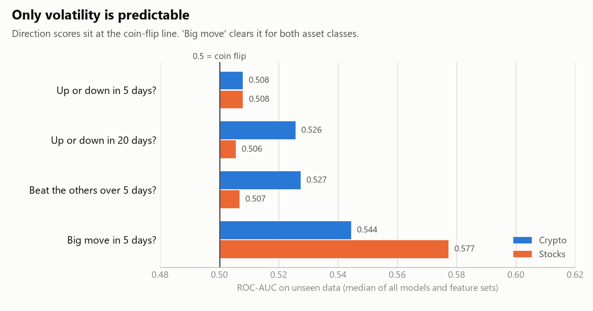
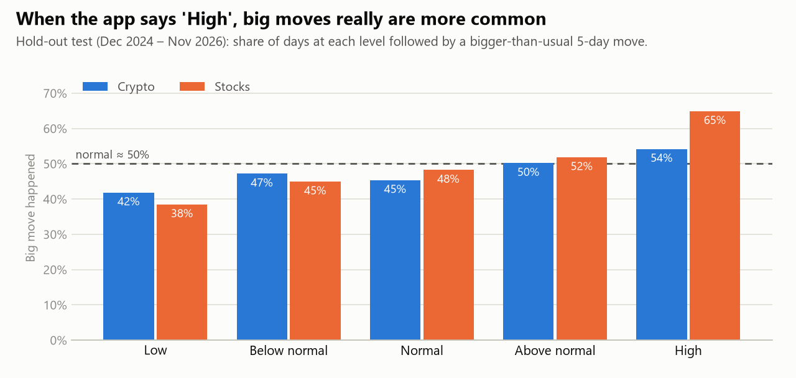
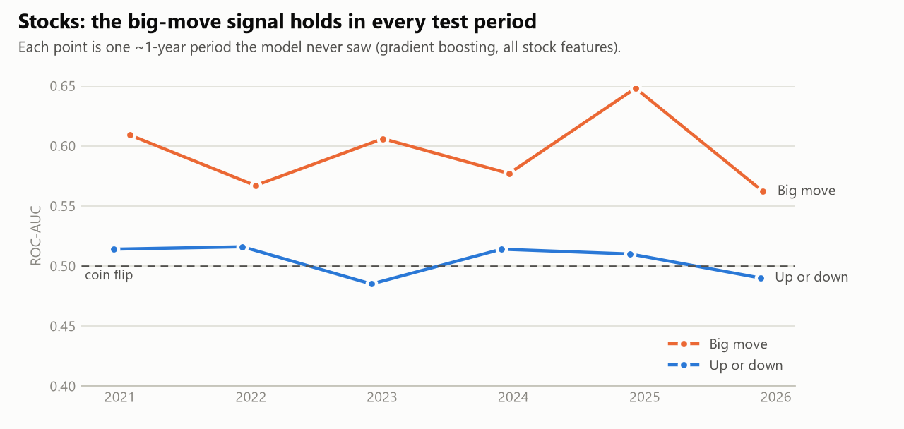

# Crypto Stock ML AI Project

[](https://github.com/baotran1109/Crypto-Stock-ML-AI-Project/actions/workflows/tests.yml)

A machine learning project for cryptocurrencies and stocks that **tests honestly what can and can't be predicted**, and builds its dashboard around what held up.

- **Up or down?** Not predictable from price, volume, funding rates, sentiment, earnings or macro data. Every model tested scores about the same as a coin flip.
- **Big move coming?** Predictable, for crypto and stocks alike, and better than random in every test period. That's the app's headline forecast.

<picture>
  <source media="(prefers-color-scheme: dark)" srcset="reports/figures/auc_by_question-dark.png">
  
</picture>

## What It Does

- Loads OHLCV data from Yahoo Finance (CoinGecko as a fallback for some coins), plus non-price data:
  - Crypto: funding rates and the Fear & Greed index.
  - Stocks: earnings surprises, analyst ratings, yield curve and credit spreads.
- Trains **two models per asset class** (crypto: 10 coins; stocks: 10 large stocks/ETFs):
  - **Big-move model:** will the next 5 bars move more than usual, either direction? Test ROC-AUC 0.55 crypto, 0.60 stocks.
  - **Direction model:** up or down in 5 bars? Kept for transparency; it scores about 0.50.
- Splits train/test by date with a purge gap, evaluates walk-forward, and has automated tests that fail if any feature uses future data.
- Backtests a long-only strategy with Backtrader, out-of-sample by default, against rule-based benchmarks and a shuffle test. Volatility-based sizing is on by default.
- Includes a signal research harness with 170+ walk-forward experiments, a 100-stock / 40-coin large-universe mode, and rotation simulations.
- Provides a Streamlit app with four pages: Prediction, Model Performance, Backtest, and Research.

## The App

- **Prediction:** enter a symbol (e.g. BTC-USD, AAPL) and see:
  - **Big-move likelihood** (Low → High) and how often a big move really followed that level in testing.
  - The typical 5-day move size.
  - An **earnings warning** for stocks reporting within 14 days.
  - The direction call underneath, with a coin-flip warning.
- **Model Performance:** test metrics for both models per asset class, including the big-move model's hit rate per level.
- **Backtest:** ML strategy vs buy & hold, SMA crossover, momentum and RSI rules, plus a shuffle test. Risk rules: volatility sizing (on by default), minimum holding period, slippage.
- **Research:** the findings and every experiment table.

<picture>
  <source media="(prefers-color-scheme: dark)" srcset="reports/figures/bigmove_levels-dark.png">
  
</picture>

## Setup

1. Create and activate a virtual environment: `python -m venv venv` then `venv\Scripts\activate` (Windows) or `source venv/bin/activate`.
2. Install dependencies: `pip install -r requirements.txt` (and `pip install -r requirements-dev.txt` for tests and charts).
3. Train the models: `python -m src.refresh` (downloads data and trains both model types for both asset classes).
4. Run the app: `streamlit run app/streamlit_app.py`.

Python 3.11 or newer is required (settings are read with `tomllib`).

## Commands

| Command | What it does |
|---|---|
| `python -m src.refresh` | Refresh all data and retrain every model. `--research` also reruns the research, `--data-only` skips training. |
| `python -m src.train_model` | Train the direction models only. |
| `python -m src.vol_model` | Train the big-move models only. |
| `python -m src.research` | Full research grid on the default universe (~5 min). `--quick` skips random forest, `--no-rotation` skips rotation. |
| `python -m src.research --universe large --quick` | Research on ~100 stocks and ~40 coins; writes `reports/large/`. |
| `python -m pytest -q` | Run the test suite (offline, synthetic data). |
| `python scripts/make_charts.py` | Regenerate the README charts in `reports/figures/`. |

### Keeping it up to date

Windows Task Scheduler, every weekday at 07:00 (replace the folder path):

```
schtasks /Create /SC WEEKLY /D MON,TUE,WED,THU,FRI /ST 07:00 /TN "CryptoStockML refresh" /TR "cmd /c cd /d C:\path\to\project && venv\Scripts\python.exe -m src.refresh >> refresh.log 2>&1"
```

The sidebar of the app shows when each model was last trained.

## Configuration

All settings live in **`config.toml`**:
- Symbol universes, default and large.
- Prediction horizon and training lookback.
- Test split and research folds.
- Backtest defaults: capital, commission, slippage, volatility sizing.

## Deploying (Streamlit Community Cloud)

1. Push this repository to GitHub (cached data and trained models are committed, so the app works without retraining).
2. Go to share.streamlit.io, sign in with GitHub, click **Create app**, pick this repository, branch `main`, main file `app/streamlit_app.py`.
3. Under **Advanced settings**, choose Python 3.12. Deploy.

Yahoo Finance sometimes rate-limits cloud servers. When a download fails, the app falls back to the cached data in `data/`, so it keeps working with the last committed prices.

## Project Structure

- **config.toml / src/config.py** – Settings, loaded once and shared by every module.
- **src/data_loader.py** – Loads OHLCV from Yahoo Finance (CoinGecko fallback), caches CSVs under `data/`, falls back to a stale cache if offline.
- **src/features.py** – Scale-free technical indicators and the 5-day up/down dataset.
- **src/alt_data.py** – Non-price data, cached under `data/alt/`:
  - Fear & Greed index, Deribit and Hyperliquid funding rates.
  - yfinance earnings, next earnings date and analyst actions.
  - FRED yield curve and credit spread.
- **src/model_registry.py** – Asset-class detection and loading each class's artifacts.
- **src/train_model.py** – Direction models: date split, walk-forward CV, saved to `artifacts/<asset_class>/`.
- **src/vol_model.py** – Big-move models: walk-forward and hold-out scoring, per-level hit rates, live prediction.
- **src/backtest.py** – One Backtrader engine for the ML strategy, benchmarks and shuffle test, with risk rules.
- **src/research.py** – Research harness: targets × feature sets × models, walk-forward, rotation simulation, large-universe mode.
- **src/refresh.py** – One command to refresh data and retrain.
- **app/streamlit_app.py** – Streamlit UI.
- **tests/** – pytest suite, run on every push by GitHub Actions (`.github/workflows/tests.yml`). It covers:
  - No-look-ahead checks for every feature builder and for when earnings and analyst data become usable.
  - The backtest engine.
  - Walk-forward sanity: random features score ~0.5, a real signal is detected.
- **scripts/make_charts.py** – README charts.
- **reports/** – `FINDINGS.md` (summary), every experiment table, `large/` (large-universe run), `figures/`.

## How Results Are Kept Honest

- **Date-based splits with a purge gap:** no training label overlaps the test period.
- **Walk-forward evaluation:** a result counts only if it beats random in every test period, not just on average.
- **Leak tests:** every feature builder is tested so that adding future data can't change a past value. When a leak was planted on purpose, the tests caught it.
- **Delayed non-price data:** each value is used only after it became public. Earnings, analyst actions and FRED data are used from the day after.
- **Out-of-sample backtests:** they start after the training period, use the same engine and costs for every benchmark, and include a shuffle test.
- **Every experiment is reported,** including the failures, with a multiple-testing caveat.

<picture>
  <source media="(prefers-color-scheme: dark)" srcset="reports/figures/stock_periods-dark.png">
  
</picture>

## Research Findings (short version)

See [`reports/FINDINGS.md`](reports/FINDINGS.md) for detail.

- **Price direction (up/down in 5 or 20 days) is not predictable** from any data tried, for crypto or stocks. Test ROC-AUC stays around 0.50.
- **Volatility is predictable.** Whether the next 5 days will have a big move scores ROC-AUC ~0.55 for crypto and ~0.60 for stocks, in every test period. Earnings dates help most.
- **Funding rates, Fear & Greed, earnings surprises, analyst ratings, yield curve and credit spreads** did not make direction predictable.
- **On 99 stocks**, nothing predicts direction or which stocks will outperform. A 20-day lead seen on 10 stocks disappeared.
- **Which coin will beat the other coins** is weakly but consistently predictable (~0.53). On 10 coins a rotation built on it doesn't beat holding all coins. On 39 coins it beat holding all coins in 13 of 13 setups, but with 71–90% drawdowns and a coin list chosen with hindsight. It's a lead to retest with a point-in-time coin list, not a strategy.

## Notes

- Use BTC-USD, ETH-USD for crypto (not BTC-USDT) and plain tickers (AAPL, TSLA) for stocks. Any ticker ending in `-USD` uses the crypto models.
- A single backtest on one symbol is noisy. The same model can beat every benchmark on one stock and lose on the next.
- Nothing here is investment advice.
